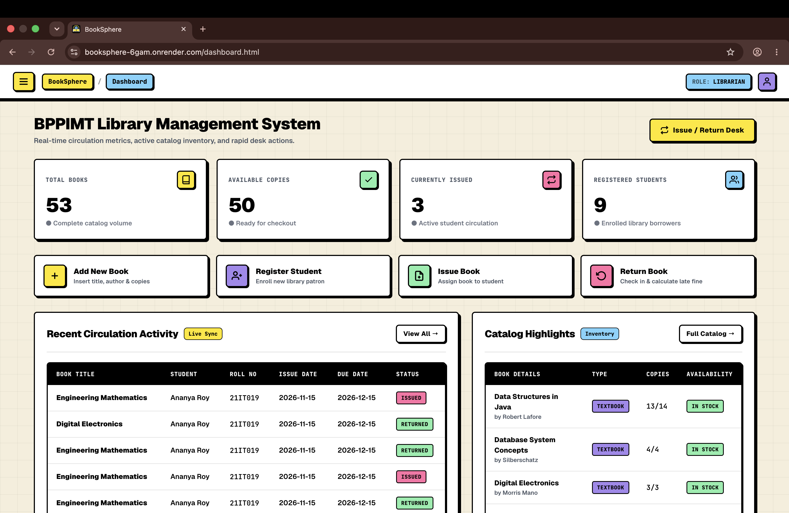
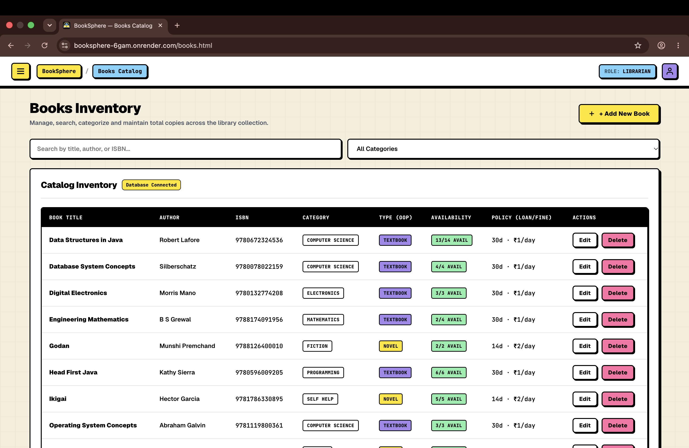
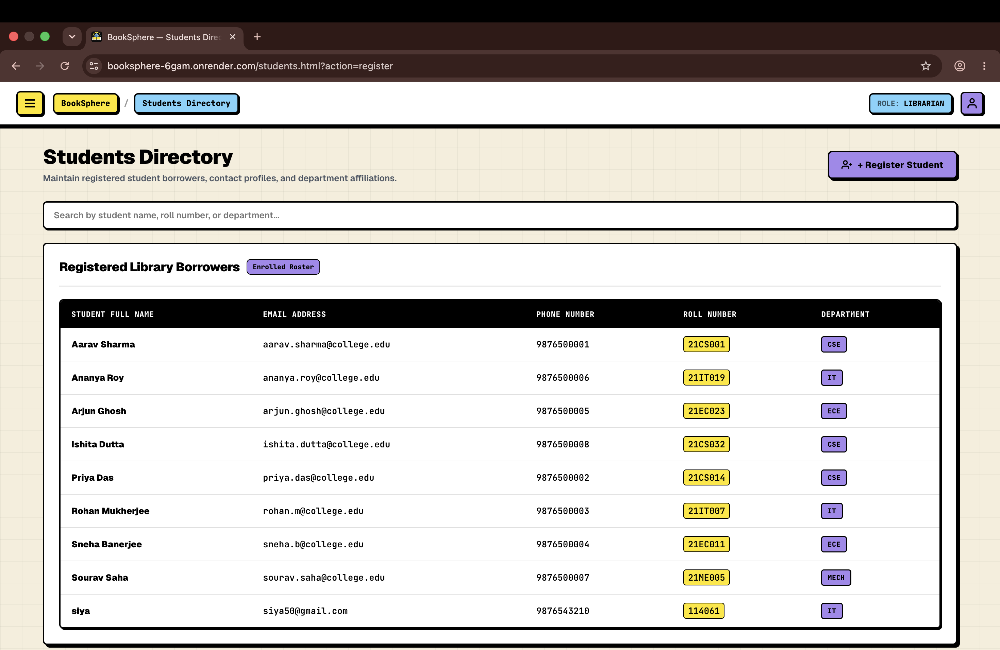
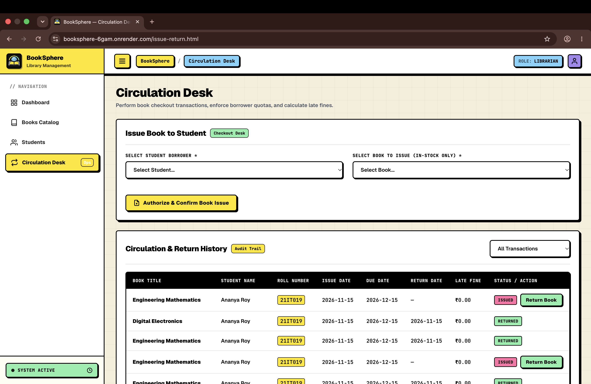
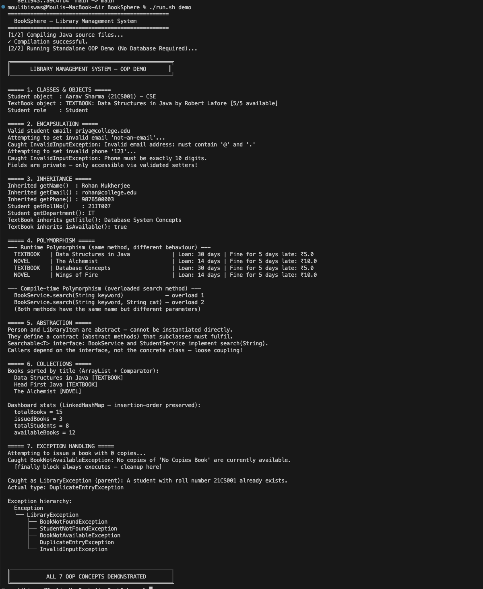

# 📚 BookSphere – Object-Oriented Library Management System

[](https://www.oracle.com/java/)
[](https://www.mysql.com/)
[](https://www.docker.com/)
[](https://github.com/brettwooldridge/HikariCP)
[](https://booksphere-6gam.onrender.com/)


A **Library Management System** built with **Core Java**, **JDBC + MySQL** and a **Neo-Brutalism web interface** — no frameworks, no ORM. Created as a college **OOP Lab Mini Project** to demonstrate all seven core OOP concepts in a real, working application.

🔗 **Live Demo:** [https://booksphere-6gam.onrender.com/](https://booksphere-6gam.onrender.com/)
> Free-tier hosting may take ~30–50 seconds to wake up on the first request.

---

## 📑 Table of Contents

1. [Overview](#-overview)
2. [Features](#-features)
3. [Screenshots](#-screenshots)
4. [Tech Stack & Tools](#-tech-stack--tools)
5. [OOP Concepts Implemented](#-oop-concepts-implemented)
6. [Architecture & Workflow](#-architecture--workflow)
7. [Project Structure](#-project-structure)
8. [Database Design](#-database-design)
9. [Getting Started](#-getting-started)
10. [Docker & Deployment](#-docker--deployment)
11. [Environment Variables](#-environment-variables)
12. [Future Improvements](#-future-improvements)
13. [Author](#-author)

---

## 🎯 Overview

Most tutorials rely on Spring Boot or Hibernate, which hide how things really work. **BookSphere** does the opposite:

- **Pure Core Java** – uses only the standard library and the built-in `com.sun.net.httpserver.HttpServer`.
- **Pure JDBC** – every query is a hand-written `PreparedStatement` (SQL-injection safe, manual transactions).
- **Custom utilities** – `JsonBuilder`, `FormParser` and `Validator` replace Jackson/Gson/Lombok.
- **HikariCP connection pooling** – fast, thread-safe database connections.
- **Single-port design** – port `8080` serves both the frontend and the `/api/*` routes, so there are no CORS issues and only one command to run.

---

## ✨ Features

**📊 Dashboard**
- Live stats: total books, available copies, active issues, registered students.
- Recent circulation activity and quick-action shortcuts.

**📚 Book Catalog**
- Full CRUD with protection against deleting books that are currently issued.
- Two book types with different policies:

  | Type | Loan Period | Late Fine |
  |---|---|---|
  | **Textbook** | 30 days | ₹1.00 / day |
  | **Novel** | 14 days | ₹2.00 / day |

- Search by title, author or ISBN, plus category filtering.
- Automatic tracking of total vs. available copies.

**👥 Student Directory**
- Registration with validation (10-digit phone, email format, unique roll number & email).
- Search by name, roll number or department.

**🔄 Circulation Desk (Issue & Return)**
- **Atomic transactions** – issue record + stock update succeed or fail together (`commit` / `rollback`).
- **Borrowing limit** – max 3 active loans per student.
- **Duplicate-issue prevention** and **zero-stock guard**.
- **Polymorphic fine calculation** – no `if/else` on book type.

**🎨 Neo-Brutalism UI**
- Bold borders, hard shadows, high-contrast colors.
- Responsive collapsible sidebar (state saved in `localStorage`), custom SVG logo and favicon set.

---

## 🖼️ Screenshots


| Dashboard | Book Catalog |
|:---:|:---:|
|  |  |

| Student Directory | Circulation Desk |
|:---:|:---:|
|  |  |

### OOP Demo (Console Output)


| Page | Live Route |
|---|---|
| Dashboard | [`/dashboard.html`](https://booksphere-6gam.onrender.com/dashboard.html) |
| Book Catalog | [`/books.html`](https://booksphere-6gam.onrender.com/books.html) |
| Student Directory | [`/students.html`](https://booksphere-6gam.onrender.com/students.html) |
| Circulation Desk | [`/issue-return.html`](https://booksphere-6gam.onrender.com/issue-return.html) |

---

## 🛠️ Tech Stack & Tools

| Category | Technology | Details |
|---|---|---|
| **Language** | Core Java 17+ | Tested on JDK 25; production runs on Eclipse Temurin 25 |
| **Web Server** | `com.sun.net.httpserver.HttpServer` | Built into the JDK, fixed thread pool (`Executors.newFixedThreadPool(10)`) |
| **Database** | MySQL 8.0+ | Local; TiDB Serverless Cloud used for deployment |
| **DB Access** | JDBC (`PreparedStatement`) | No ORM, manual transaction control |
| **JDBC Driver** | MySQL Connector/J `26.10.0` | Official MySQL driver |
| **Connection Pool** | HikariCP `6.3.0` | Uses SLF4J API `2.0.17` for logging |
| **JSON / Parsing** | Custom `JsonBuilder`, `FormParser` | Zero external dependencies |
| **Frontend** | HTML5, CSS3, Vanilla JavaScript (ES6+) | `fetch` API, `async/await`, `localStorage`, Flexbox, CSS Grid |
| **Assets** | SVG, PNG, ICO | Custom logo and favicon set |
| **Containerization** | Docker (multi-stage) | `eclipse-temurin:25-jdk` (build) → `eclipse-temurin:25-jre` (runtime) |
| **Hosting** | Render | Docker web service |
| **Scripts** | `run.sh`, `run.bat` | One-click compile & run (Linux/macOS & Windows) |
| **Version Control** | Git & GitHub | Source hosting |

---

## 🧩 OOP Concepts Implemented

| # | Concept | Where It's Used | Role |
|---|---|---|---|
| 1 | **Classes & Objects** | `Person`, `Student`, `LibraryItem`, `TextBook`, `Novel`, `IssueRecord` | Real-world entities as Java objects |
| 2 | **Encapsulation** | `Person`, `LibraryItem`, `IssueRecord` | Private fields with validating setters |
| 3 | **Inheritance** | `Student → Person`, `TextBook / Novel → LibraryItem`, `*Handler → BaseHandler` | Code reuse via `extends` / `super()` |
| 4 | **Polymorphism** | Overriding: `calculateFine()`, `getLoanPeriodDays()`; Overloading: `BookService.search()` | Runtime dispatch & compile-time overloading |
| 5 | **Abstraction** | `abstract Person`, `abstract LibraryItem`, `abstract BaseHandler`, `interface Searchable<T>` | Contracts without implementation details |
| 6 | **Collections** | `ArrayList`, `List<T>`, `LinkedHashMap`, `Comparator.comparing` | Data storage, sorting, ordered metrics |
| 7 | **Exception Handling** | Custom `LibraryException` hierarchy, `try-with-resources` | Clean error handling & auto resource closing |

### Key Code Snippets

**Encapsulation** – defensive setter:
```java
public void setTotalCopies(int totalCopies) throws InvalidInputException {
    if (totalCopies < 0) {
        throw new InvalidInputException("Total copies cannot be negative.");
    }
    this.totalCopies = totalCopies;
}
```

**Polymorphism** – each subclass defines its own policy:
```java
// TextBook.java
@Override public int getLoanPeriodDays() { return 30; }
@Override public double calculateFine(long daysLate) { return daysLate > 0 ? daysLate * 1.0 : 0.0; }

// Novel.java
@Override public int getLoanPeriodDays() { return 14; }
@Override public double calculateFine(long daysLate) { return daysLate > 0 ? daysLate * 2.0 : 0.0; }
```
`IssueService` simply calls `item.calculateFine(daysLate)` — no `instanceof` checks. `BookDao.createItem(ResultSet)` acts as a factory, returning the right subclass based on the `book_type` column.

**Overloading** – two search signatures:
```java
public List<LibraryItem> search(String keyword) throws SQLException;
public List<LibraryItem> search(String keyword, String category) throws SQLException;
```

**Abstraction** – generic interface:
```java
public interface Searchable<T> {
    List<T> search(String keyword) throws SQLException;
}
```

**Exception hierarchy** (all extend the checked `LibraryException`): `BookNotFoundException`, `StudentNotFoundException`, `BookNotAvailableException`, `DuplicateEntryException`, `InvalidInputException`. Handlers map them to HTTP `400`, `404` and `500` responses.

---

## 🏗️ Architecture & Workflow

BookSphere follows a clean **layered architecture**:

```text
Browser (HTML / CSS / JS)
        │  HTTP (JSON / URL-encoded)
        ▼
Handler Layer   → BaseHandler, BookHandler, StudentHandler, IssueHandler, DashboardHandler
        ▼
Service Layer   → BookService, StudentService, IssueService, DashboardService
        ▼         (business rules, validation, quotas, fines)
DAO Layer       → BookDao, StudentDao, IssueDao
        ▼         (PreparedStatements, transactions)
HikariCP Pool → MySQL (students, books, issue_records)
```

**Workflow: issuing a book** (`POST /api/issue`)
1. `IssueHandler` reads the parameters and calls `IssueService.issueBook(studentId, bookId)`.
2. The service checks: student exists → fewer than 3 active loans → no duplicate loan → copies available.
3. Due date is computed polymorphically: `today.plusDays(item.getLoanPeriodDays())`.
4. `IssueDao` runs one transaction: insert into `issue_records` → decrement `available_copies` → `commit`.
5. A JSON success response is returned and the UI shows a toast.

---

## 📁 Project Structure

```text
BookSphere/
├── Dockerfile              # Multi-stage build
├── schema.sql              # Database schema + seed data
├── db.properties           # Local DB config (fallback)
├── .env.docker             # Docker env template
├── run.sh / run.bat        # One-click run scripts
├── lib/                    # HikariCP, MySQL Connector/J, SLF4J API jars
├── src/com/library/
│   ├── Main.java           # Server bootstrap & routing
│   ├── dao/                # BookDao, StudentDao, IssueDao, DBConnection
│   ├── model/              # Person, Student, LibraryItem, TextBook, Novel, IssueRecord
│   ├── service/            # BookService, StudentService, IssueService, DashboardService, Searchable
│   ├── handler/            # BaseHandler, Book/Student/Issue/Dashboard/StaticFile handlers
│   ├── exception/          # LibraryException + 5 custom exceptions
│   ├── util/               # JsonBuilder, FormParser, Validator
│   └── demo/OopDemo.java   # Offline demo of all 7 OOP concepts
└── frontend/
    ├── *.html              # dashboard, books, students, issue-return
    ├── css/style.css       # Neo-Brutalism design system
    ├── js/                 # api, common, dashboard, books, students, issue-return
    └── assets/             # Logo and favicons
```

---

## 🗄️ Database Design

Database: `library_db` — 3 tables in 3NF.

| Table | Key Columns | Constraints |
|---|---|---|
| **students** | `student_id`, `name`, `email`, `phone`, `roll_no`, `department`, `created_at` | `email` UNIQUE, `roll_no` UNIQUE |
| **books** | `book_id`, `title`, `author`, `isbn`, `category`, `book_type`, `total_copies`, `available_copies`, `created_at` | `isbn` UNIQUE, `book_type ENUM('TEXTBOOK','NOVEL')`, `CHECK (available_copies >= 0)` |
| **issue_records** | `issue_id`, `book_id`, `student_id`, `issue_date`, `due_date`, `return_date`, `fine`, `status` | FKs to `books` and `students` with `ON DELETE RESTRICT`; `status ENUM('ISSUED','RETURNED')` |

**Relationships:** one student → many issue records; one book → many issue records.

*(Optional: add your ER diagram here)*


---

## 🚀 Getting Started

### Prerequisites
- **JDK 17+** (21 or 25 recommended) – check with `java -version`
- **MySQL 8.0+** – check with `mysql --version`
- **Git**
- **Docker** *(optional)*

### 1. Clone the repository
```bash
git clone https://github.com/mouli-tech2025/BookSphere.git
cd BookSphere
```

### 2. Set up the database
```bash
mysql -u root -p < schema.sql
```
This creates `library_db` with 8 students, 12 books and 5 sample issue records.

### 3. Configure the connection
The app checks environment variables (`DB_URL`, `DB_USER`, `DB_PASSWORD`) first, then falls back to `db.properties`:
```properties
db.url=jdbc:mysql://localhost:3306/library_db?useSSL=false&allowPublicKeyRetrieval=true&serverTimezone=UTC
db.user=root
db.password=your_mysql_password
```

HikariCP defaults: max pool size 5, min idle 1, connection timeout 10 s, idle timeout 5 min, max lifetime 25 min, pool name `BookSpherePool`.

### 4. Run the project

**Option A – Scripts (recommended)**
```bash
# Linux / macOS
chmod +x run.sh
./run.sh          # start the web app
./run.sh demo     # run the OOP console demo

# Windows
run.bat
run.bat demo
```

**Option B – Manual**
```bash
# Compile
javac -cp "lib/*" -d out $(find src -name "*.java")          # Linux / macOS
javac -cp "lib/*" -d out src/com/library/*.java src/com/library/*/*.java   # Windows

# Run the server
java -cp "out:lib/*" com.library.Main      # Linux / macOS
java -cp "out;lib/*" com.library.Main      # Windows

# Run the OOP demo (no MySQL needed)
java -cp "out:lib/*" com.library.demo.OopDemo   # use ; on Windows
```

Open **http://localhost:8080** in your browser.

---

## 🐳 Docker & Deployment

**Build and run locally**
```bash
docker build -t booksphere:latest .

docker run -d -p 8080:8080 --env-file .env.docker --name booksphere-app booksphere:latest

docker logs -f booksphere-app
```

Example `.env.docker` (never commit real passwords):
```env
DB_URL=jdbc:mysql://host.docker.internal:3306/library_db?useSSL=false&allowPublicKeyRetrieval=true
DB_USER=root
DB_PASSWORD=your_password
PORT=8080
```
*(On Linux, replace `host.docker.internal` with your host IP or Docker bridge address.)*

**Deploy on Render (or Railway / Fly.io)**
1. Create a **Web Service** and choose the **Docker** environment.
2. Set `PORT`, `DB_URL`, `DB_USER`, `DB_PASSWORD` as environment variables.
3. Use a cloud MySQL URL with SSL, e.g.
   `jdbc:mysql://<cloud-host>:4000/library_db?useSSL=true&sslMode=VERIFY_IDENTITY`
4. Health checks: `/` and `/api/dashboard` both return HTTP 200.

---

## ⚙️ Environment Variables

| Variable | Required | Default | Description |
|---|---|---|---|
| `PORT` | No | `8080` | HTTP server port |
| `DB_URL` | No | from `db.properties` | JDBC connection URL |
| `DB_USER` | No | from `db.properties` | Database username |
| `DB_PASSWORD` | No | from `db.properties` | Database password |

---

## 🔮 Future Improvements

- **JWT / session authentication** with Librarian and Student roles
- **Barcode / QR scanning** of ISBNs through the browser camera
- **Automated overdue reminders** by email (JavaMail)
- **Pagination and export** of reports to CSV / PDF

---


- **GitHub:** [mouli-tech2025/BookSphere](https://github.com/mouli-tech2025/BookSphere)
- **Live Demo:** [booksphere-6gam.onrender.com](https://booksphere-6gam.onrender.com/)

---

*Built with Core Java and clean object-oriented design.*
